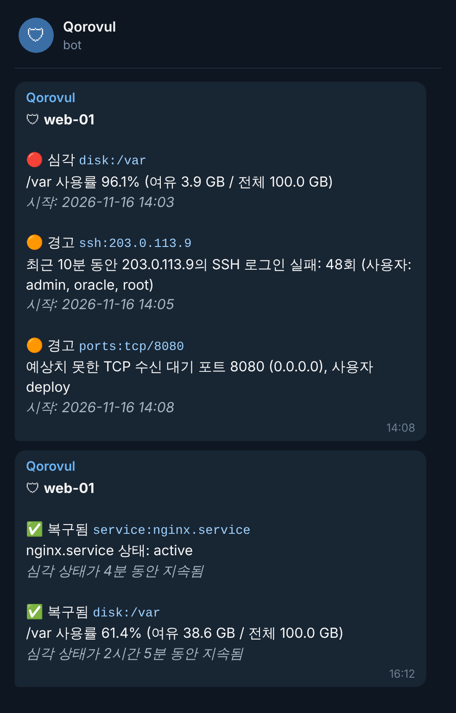

# Qorovul

[English](README.md) · [Oʻzbekcha](README.uz.md) · [Русский](README.ru.md) · [Türkçe](README.tr.md) · **한국어**

**Qorovul**(우즈베크어로 "파수꾼")은 가벼운 Linux 서버 감시 도구입니다.
감시 대상 서버 자체에서 systemd 서비스로 실행되며, 알림을 Telegram으로 보냅니다.

웹 UI, 데이터베이스, 열린 인바운드 포트, 중앙 서버가 없습니다. Python 프로세스
하나로 메모리 약 33 MB, CPU 코어 하나의 1% 미만을 사용합니다.

Qorovul은 여섯 가지를 감시합니다.

| 검사      | 알림 조건 | 키 |
|-----------|-----------|----|
| `disk`    | 파일 시스템 사용률 85% 이상 (95% 이상이면 심각) | `disk:/var` |
| `memory`  | RAM 사용률이 3회 연속 90% 이상 (97% 이상이면 심각) | `memory:ram` |
| `service` | 지정한 systemd 유닛이 `active`가 아님 | `service:nginx.service` |
| `ssh`     | 한 IP에서 10분 동안 SSH 로그인 실패 20회 도달 | `ssh:203.0.113.9` |
| `ssl`     | 도메인 인증서가 14일 이내 만료 (3일 이내면 심각) | `ssl:example.com` |
| `ports`   | 허용 목록에 없는 TCP 포트가 수신 대기 | `ports:tcp/8080` |

알림은 **한 번만** 보냅니다. 문제가 cooldown(기본 6시간) 이후에도 계속되면
재알림을 보내고, 문제가 해결되면 **복구됨** 메시지를 보냅니다.



---

## 60초 빠른 시작

1. **봇을 만듭니다.** Telegram에서 [@BotFather](https://t.me/BotFather)에게
   `/newbot`을 보내고 토큰(`123456789:AAE...`)을 복사합니다.
2. **chat id를 확인합니다.** 새 봇에게 아무 메시지나 보낸 뒤
   `https://api.telegram.org/bot<TOKEN>/getUpdates`를 열어
   `"chat":{"id": ...}` 값을 복사합니다. 그룹이라면 먼저 봇을 그룹에 추가하세요.
   그룹 id는 음수입니다.
3. **서버에 설치합니다** (systemd가 있는 Ubuntu 22.04, 24.04, 26.04, Debian 12+, AlmaLinux/RHEL 9).

   ```bash
   curl -fsSL https://raw.githubusercontent.com/Qoshmurod/Security-/main/install.sh | sudo bash
   ```

   설치 프로그램이 언어, 토큰, chat id를 묻고 서비스를 시작한 뒤 테스트
   메시지를 보냅니다. 질문 없이 설치하려면:

   ```bash
   curl -fsSL https://raw.githubusercontent.com/Qoshmurod/Security-/main/install.sh \
     | sudo QOROVUL_LANGUAGE=ko QOROVUL_BOT_TOKEN='123456789:AAE...' QOROVUL_CHAT_ID='123456789' bash
   ```

4. `/etc/qorovul/config.yml`에 **서버 정보를 알려 줍니다.** 감시할 서비스,
   도메인, 열려 있어야 하는 포트를 적습니다.

   ```yaml
   checks:
     service: { units: [nginx, postgresql] }
     ssl:     { domains: [example.com] }
     ports:   { allowed: [22, 80, 443] }
   ```

   그다음: `sudo systemctl restart qorovul && sudo -u qorovul qorovul test`.

끝입니다. 현재 상태는 `qorovul status`로 볼 수 있습니다.

---

## 언어

Telegram 메시지, 검사 결과, `qorovul test`와 `qorovul status`는 14개 언어를
지원합니다.

`en` English · `uz` Oʻzbekcha · `ru` Русский · `tr` Türkçe · `ko` 한국어 ·
`zh` 简体中文 · `ja` 日本語 · `es` Español · `pt` Português · `fr` Français ·
`de` Deutsch · `ar` العربية · `hi` हिन्दी · `id` Bahasa Indonesia

```yaml
language: ko        # 또는 auto: 서버 로캘($LANG)을 따름
```

명령 하나에만 적용하려면 `qorovul status --lang ko`를 사용합니다. 서비스에서는
`QOROVUL_LANG` 환경 변수가 설정을 덮어씁니다.

숫자와 시간은 언어 관례를 따릅니다(예: `2시간 5분`). `qorovul status` 표는
한글 폭을 계산해 열을 맞춥니다. 저널 로그와 설정 오류는 검색과 버그 보고를
위해 의도적으로 영어로 남겨 둡니다.

---

## 알림 동작 방식

모든 결과에는 고정된 **키**가 있고, 키마다 상태가
`/var/lib/qorovul/state.json`에 저장됩니다. 그래서 재시작, 업그레이드, 비정상
종료 후에도 이미 받은 알림을 다시 보내지 않습니다.

| 상황 | 받는 메시지 |
|------|-------------|
| 문제가 발생함 | **알림** 한 번 |
| 문제가 계속됨 | 없음 (매 검사마다 보내지 않음) |
| `cooldown`(6시간) 후에도 계속됨 | **여전히** 재알림 한 번, 이후 6시간마다 |
| 심각도 상승 (경고 → 심각) | cooldown과 관계없이 즉시 |
| 2회 연속 정상 | **복구됨** 한 번 |
| 알림을 받기 전에 복구됨 | 없음 |
| 짧은 일시적 장애 (예: 서비스 재시작 중) | 없음 |
| 방해 금지 시간, 심각 아님 | 보류했다가 방해 금지 시간이 끝나면 전송 |
| 방해 금지 시간, 심각 | 즉시 |
| Telegram 연결 불가 | 전달될 때까지 재시도 (30초, 1분, 2분 … 5분마다) |

### 서버 전체가 다운되면

Qorovul은 감시 대상 서버에서 실행되므로 서버 자체가 다운되면 알릴 수
없습니다. 이를 위해 `heartbeat.url`에 "dead man's switch" 서비스의 ping 주소를
넣으세요(healthchecks.io, Uptime Kuma "push" 모니터 등). Qorovul이 5분마다
요청을 보내고, ping이 끊기면 *그 서비스*가 알려 줍니다.

Qorovul 프로세스가 멈추면 systemd가 감지하여(`WatchdogSec=10min`) 프로세스를
종료하고 다시 시작합니다.

---

## 권한

Qorovul은 권한 없는 **`qorovul`** 사용자로 실행됩니다. capability가 없고
`NoNewPrivileges`가 켜져 있으며 파일 시스템은 읽기 전용입니다. 쓸 수 있는
곳은 `/var/lib/qorovul`뿐입니다.

디스크, 메모리, 서비스, 포트, 인증서 검사에는 **추가 권한이 필요 없습니다**.
포트는 `/proc/net/tcp`에서 읽으므로 `ss`나 root를 쓰지 않습니다. SSH 로그
읽기 권한만 표준 그룹으로 부여합니다. Debian/Ubuntu의 `/var/log/auth.log`는
`adm` 그룹, journald는 `systemd-journal` 그룹입니다.

포트 알림에 프로세스 이름을 표시하는 기능은 선택 사항이며 기본적으로
꺼져 있습니다. 필요한 권한이 모든 파일을 읽을 수 있게 하기 때문입니다.
켜는 방법은 [영어 README](README.md#optional-process-names-in-port-alerts)에
있습니다.

---

## 명령

```
qorovul run [--once]     메인 루프 (systemd가 실행)
qorovul test             모든 검사를 한 번 실행하고 테스트 메시지 전송
qorovul status [--json]  현재 상태와 키별 마지막 알림
qorovul version
```

모든 명령은 `-c 파일`과 `--lang 언어`를 받습니다.

### 제거

```bash
sudo systemctl disable --now qorovul
sudo rm -rf /etc/systemd/system/qorovul.service /etc/systemd/system/qorovul.service.d \
            /opt/qorovul /usr/local/bin/qorovul /var/lib/qorovul /etc/qorovul
sudo userdel qorovul
sudo systemctl daemon-reload
```

---

모든 설정의 자세한 설명, 테스트, 설치 세부 사항은 [영어 README](README.md)에
있습니다. 모든 설정은 [`config.example.yml`](config.example.yml)에 주석으로
설명되어 있습니다.

라이선스: [MIT](LICENSE)
