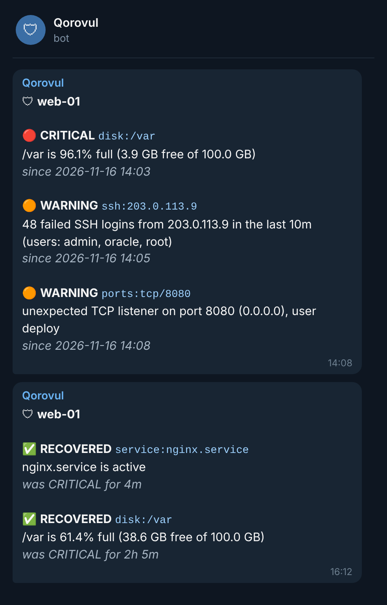

# Qorovul

[](https://github.com/Qoshmurod/Security-/actions/workflows/ci.yml)

**Qorovul** (Uzbek for *sentry*) is a small Linux server watchdog. It runs as a
systemd service on the machine it watches and sends alerts to Telegram.

No web UI, no database, no inbound ports, no central server. One Python process,
about 33 MB of RAM and under 1 % of one CPU core.

It watches six things:

| Check     | Alerts when                                                           | Key               |
|-----------|-----------------------------------------------------------------------|-------------------|
| `disk`    | a mounted filesystem is ≥ 85 % full (critical at ≥ 95 %)              | `disk:/var`       |
| `memory`  | RAM usage is ≥ 90 % for 3 checks in a row (critical at ≥ 97 %)        | `memory:ram`      |
| `service` | a listed systemd unit is not `active`                                 | `service:nginx.service` |
| `ssh`     | one IP reaches 20 failed SSH logins within 10 minutes                 | `ssh:203.0.113.9` |
| `ssl`     | a domain's certificate expires within 14 days (critical within 3)     | `ssl:example.com` |
| `ports`   | a TCP port is listening that is not on your allowlist                 | `ports:tcp/8080`  |

Alerts are **sent once**. You get a reminder only if the problem is still there
after a cooldown (6 h by default), and a **RECOVERED** message when it clears.
An optional heartbeat URL tells you when the whole server goes silent.



---

## 60-second quickstart

1. **Create a bot.** In Telegram, message [@BotFather](https://t.me/BotFather),
   send `/newbot` and copy the token (`123456789:AAE...`).
2. **Get your chat id.** Send any message to your new bot, then open
   `https://api.telegram.org/bot<TOKEN>/getUpdates` and copy `"chat":{"id": ...}`.
   For a group, add the bot to the group first; group ids are negative.
3. **Install** on the server (Ubuntu 22.04+, Debian 12+, AlmaLinux/RHEL 9 and
   similar with systemd):

   ```bash
   curl -fsSL https://raw.githubusercontent.com/Qoshmurod/Security-/main/install.sh | sudo bash
   ```

   The installer asks for the token and chat id, starts the service and sends
   a test message. To skip the prompts:

   ```bash
   curl -fsSL https://raw.githubusercontent.com/Qoshmurod/Security-/main/install.sh \
     | sudo QOROVUL_BOT_TOKEN='123456789:AAE...' QOROVUL_CHAT_ID='123456789' bash
   ```

4. **Tell it about your server** in `/etc/qorovul/config.yml`: the services
   to watch, your domains, and the ports you expect to be open:

   ```yaml
   checks:
     service: { units: [nginx, postgresql] }
     ssl:     { domains: [example.com] }
     ports:   { allowed: [22, 80, 443] }
   ```

   Then run `sudo systemctl restart qorovul && sudo -u qorovul qorovul test`.

That's it. `qorovul status` shows what it currently knows.

---

## How alerting works

This is the part Qorovul is strict about. Every result has a stable **key**,
and for each key the state is kept in `/var/lib/qorovul/state.json`, so a
restart, upgrade or crash does not repeat alerts you have already received.

| Situation                                        | What you get                                   |
|--------------------------------------------------|------------------------------------------------|
| A condition becomes true                         | one **ALERT**                                  |
| It stays true                                    | nothing, every cycle                           |
| …still true after `cooldown` (6 h)               | one **STILL FAILING** reminder, then every 6 h |
| Severity goes up (warning → critical)            | **ESCALATED** right away, cooldown ignored     |
| Severity goes down                               | nothing                                        |
| Healthy for `recovery_cycles` (2) checks in a row | one **RECOVERED**                             |
| It cleared before you were ever alerted          | nothing (no recovery for an alert you never got) |
| A blip shorter than `confirm_cycles`             | nothing (e.g. a unit caught mid-restart)       |
| Severity below `min_severity`                    | nothing, ever                                  |
| Quiet hours, not critical                        | held, then delivered when quiet hours end if still relevant |
| Quiet hours, critical                            | delivered right away                           |
| Telegram is unreachable                          | kept and retried (30 s, 1 m, 2 m … every 5 m) until delivered |
| A check itself crashes (e.g. log not readable)   | one ALERT on `<check>:error`; RECOVERED when it works again |

Some details:

* `recovery_cycles: 2` stops a value sitting right on a threshold (say a disk
  going 84.9 % → 85.0 % → 84.9 %) from sending alert/recovered pairs all day.
  `confirm_cycles` does the same on the way in: `service` waits for 2 failing
  checks, `memory` for 3 (its `sustained_cycles`). These counters are stored
  in `state.json` as well, so a restart does not reset them.
* If something recovers during quiet hours and fails again before the
  RECOVERED went out, it is treated as the same incident. You get no
  duplicate alert.
* When a check runs normally and stops reporting a key that was failing
  (a port closed, an IP stopped attacking, a filesystem was unmounted), that
  key counts as cleared. When a check *errors*, its keys are left alone, so
  "could not look" is never read as "all clear".
* Events are sent in as few messages as possible. They are marked delivered
  only after Telegram accepts them, so a send that fails is retried and never lost.
  If Telegram ever rejects the formatting, the message is re-sent as plain text.

### When the whole server goes down

Qorovul runs on the machine it watches, so it cannot report that machine's own
death. For that, set `heartbeat.url` to a ping URL from any dead-man's-switch
service (healthchecks.io, an Uptime Kuma "push" monitor, Cronitor…). Qorovul
requests it every 5 minutes; when the pings stop, *that* service alerts you.

If the Qorovul process itself hangs, systemd notices: the unit is
`Type=notify` with `WatchdogSec=10min`, and a process that stops checking in is
killed and restarted. The integration tests freeze the process on purpose to
prove this.

---

## Configuration reference

The config lives at `/etc/qorovul/config.yml` (`-c PATH` or `$QOROVUL_CONFIG`
to override). [`config.example.yml`](config.example.yml) is fully commented
and lists every default. Unknown keys are rejected, and all errors are
reported at once with their path:

```
qorovul: invalid configuration:
  - checks.disk.treshold: unknown key (allowed: confirm_cycles, cooldown, critical_threshold, ...)
  - checks.ssh.window: must be at least 60s
```

Durations accept seconds (`30`) or `30s`, `10m`, `6h`, `1d`.

### Top level

| Key          | Default                        | Meaning |
|--------------|--------------------------------|---------|
| `hostname`   | system hostname                | Name in the message header |
| `interval`   | `30s`                          | How often checks run (min 5 s) |
| `state_file` | `/var/lib/qorovul/state.json`  | Alert state, must be writable |
| `log_level`  | `info`                         | `debug` `info` `warning` `error` |

### `telegram`

| Key         | Default                     | Meaning |
|-------------|-----------------------------|---------|
| `bot_token` | —                           | From @BotFather. Env `QOROVUL_BOT_TOKEN` overrides |
| `chat_id`   | —                           | User/group id or `@channel`. Env `QOROVUL_CHAT_ID` overrides |
| `timeout`   | `10s`                       | Per request. 3 attempts, honours rate limits |
| `api_url`   | `https://api.telegram.org`  | Only for proxies/mirrors |

To keep the token out of the config file, put it in `/etc/qorovul/qorovul.env`
(mode `0600`, root-owned), which the unit loads:

```
QOROVUL_BOT_TOKEN=123456789:AAE...
QOROVUL_CHAT_ID=123456789
```

The token is never written to the log, even inside error messages.

### `heartbeat`

| Key        | Default | Meaning |
|------------|---------|---------|
| `url`      | —       | Ping URL of a dead-man's-switch service (empty = off) |
| `interval` | `5m`    | How often it is requested (min 30 s) |
| `timeout`  | `10s`   | |

A failing ping is logged once, never sent to Telegram, and never delays checks.

### `alerts`

| Key                   | Default   | Meaning |
|-----------------------|-----------|---------|
| `min_severity`        | `warning` | `info` / `warning` / `critical`: lowest severity sent |
| `cooldown`            | `6h`      | Time between reminders while still failing (`0` = every cycle) |
| `recovery_cycles`     | `2`       | Consecutive healthy runs before RECOVERED |
| `send_recovery`       | `true`    | Send RECOVERED messages |
| `quiet_hours.enabled` | `false`   | Only critical is delivered inside the window |
| `quiet_hours.start`   | `"23:00"` | Local time, may cross midnight |
| `quiet_hours.end`     | `"07:00"` | |

### `checks.*`: keys every check accepts

| Key              | Default                         | Meaning |
|------------------|---------------------------------|---------|
| `enabled`        | `true`                          | |
| `interval`       | global `interval` (`ssl`: `1h`) | How often this check runs |
| `confirm_cycles` | `1` (`service`: 2, `memory`: `sustained_cycles`) | Consecutive failing runs before the first alert |
| `cooldown`       | `alerts.cooldown`               | Per-check override |
| `send_recovery`  | `alerts.send_recovery`          | Per-check override |

### `checks.disk`

| Key                   | Default | Meaning |
|-----------------------|---------|---------|
| `threshold`           | `85`    | Warning at ≥ this % |
| `critical_threshold`  | `95`    | Critical at ≥ this % (`null` = never) |
| `mountpoints`         | `[]`    | Watch exactly these paths, of any type (empty = auto) |
| `exclude_fstypes`     | tmpfs, devtmpfs, squashfs, overlay, … | Skipped when auto-discovering |
| `exclude_mountpoints` | `/snap`, `/var/lib/docker` | Skipped, including everything below |

Auto-discovery covers local disk-backed filesystems only. Network mounts are
skipped on purpose (a hung NFS server would otherwise hang the check); list
them in `mountpoints` if you want them. Bind mounts and btrfs subvolumes of the
same device are reported once, under the shortest path. A path listed in
`mountpoints` that cannot be read is itself reported.

### `checks.memory`

| Key                  | Default | Meaning |
|----------------------|---------|---------|
| `threshold`          | `90`    | Warning at ≥ this % |
| `critical_threshold` | `97`    | Critical at ≥ this % (`null` = never) |
| `sustained_cycles`   | `3`     | Consecutive runs at/above threshold before alerting |

Usage is `(total − available) / total`, so page cache does not count.

### `checks.service`

| Key        | Default    | Meaning |
|------------|------------|---------|
| `units`    | `[]`       | Units to watch; `nginx` means `nginx.service`; timers, sockets etc. need a suffix |
| `severity` | `critical` | |

`active` and `reloading` are healthy; anything else (`failed`, `inactive`,
`activating` …) alerts after 2 consecutive checks.

### `checks.ssh`

| Key          | Default                                 | Meaning |
|--------------|-----------------------------------------|---------|
| `source`     | `auto`                                  | `auto` = first readable log file, else journald; `file`; `journal` |
| `log_paths`  | `/var/log/auth.log`, `/var/log/secure`  | |
| `failures`   | `20`                                    | Alert when one IP reaches this many failures… |
| `window`     | `10m`                                   | …within this sliding window |
| `severity`   | `warning`                               | |
| `ignore_ips` | `[]`                                    | IPs or CIDRs never alerted on |

How failures are counted:

* Per connection: `Invalid user x` followed by `Failed password for invalid
  user x` on the same source port is **one** failure, not two. Each further
  `Failed …` line on that connection is one more.
* Key-only servers are covered (`Invalid user`, `Connection closed by
  authenticating user … [preauth]`). The `Failed none` probe that every client
  sends first is not counted as a guess.
* rsyslog's `message repeated 3 times: [ Failed password … ]` counts as 3.
* The user name is attacker-controlled, so the source address is always taken
  from the *end* of the line. A user name such as `root from 10.0.0.1 port 22`
  cannot hide the real IP or frame another one.
* The log is read incrementally. Rotation (including lines written just before
  logrotate renamed the file) and truncation are handled. On first start only
  the last 2 MB are read.
* The journal is matched by syslog identifier (`sshd`, `sshd-session`,
  `sshd-auth`), so it works for `ssh.service`, `sshd.service`, socket
  activation and the split daemons of OpenSSH 9.8+.

Tested against log samples from Ubuntu 22.04, Ubuntu 24.04, AlmaLinux 9 and
journald with OpenSSH 10 (`tests/ssh_samples.py`), and against a live sshd in
the integration tests.

On internet-facing servers bots come and go. If you don't want a RECOVERED
message for every attacker, set `send_recovery: false` on this check.

### `checks.ssl`

| Key                      | Default   | Meaning |
|--------------------------|-----------|---------|
| `domains`                | `[]`      | `example.com` or `host:port` (default 443) |
| `warn_days`              | `14`      | Warning when expiring in ≤ this many days |
| `critical_days`          | `3`       | Critical when ≤ this many days |
| `timeout`                | `10s`     | |
| `connect_error_severity` | `warning` | When the host cannot be reached (after one retry) |
| `interval`               | `1h`      | |

Certificates are fetched with full verification and SNI. An expired, untrusted
or wrong-host certificate is reported as critical, with the reason.

### `checks.ports`

| Key               | Default   | Meaning |
|-------------------|-----------|---------|
| `allowed`         | `[22]`    | `443` (any address) or `"127.0.0.1:5432"` / `"[::1]:6379"` (exact) |
| `ignore_loopback` | `true`    | Ignore listeners bound only to 127.0.0.0/8 / ::1 |
| `severity`        | `warning` | |

One alert per port, listing every address it is bound on and the user that
owns the socket. The process name is added when permitted (see below).

---

## CLI

```
qorovul run [--once]     foreground loop (what systemd runs)
qorovul test             run every check once, print results, send a test message
qorovul status [--json]  current state and the last alert per key
qorovul version
```

All commands accept `-c PATH`. Exit codes for `test`: `0` all good, `1` some
checks are failing (the message was still sent), `2` invalid config,
`3` Telegram delivery failed. `run` exits `2` on invalid config, and systemd
does not restart it in a loop for that.

```
$ sudo qorovul status
state: /var/lib/qorovul/state.json  (9 keys, 1 failing)

KEY                            STATUS   SEVERITY  SINCE            LAST ALERT                 MESSAGE
ports:tcp/8080                 FAILING  warning   2026-11-16 14:10 alert 2026-11-16 14:10     unexpected TCP listener on port 8080 (0.0.0.0), user deploy
disk:/                         ok       -         -                recovered 2026-11-15 03:12 / is 61.2% full (38.1 GB free of 98.3 GB)
...
```

`systemctl status qorovul` also shows a one-line summary such as
`Status: "9 key(s) tracked, 1 failing"`.

---

## Permissions: what needs more than an ordinary user

Qorovul runs as the unprivileged system user **`qorovul`**, with no
capabilities, `NoNewPrivileges`, and a read-only view of the filesystem
(see [`qorovul.service`](qorovul.service); `systemd-analyze security` rates it
3.1 "OK"). The only writable path is `/var/lib/qorovul`.

| Needs                          | How it is read                    | Access required |
|--------------------------------|-----------------------------------|-----------------|
| Disk usage                     | `statvfs` via psutil              | none |
| Memory                         | `/proc/meminfo` via psutil        | none |
| Service state                  | `systemctl is-active` (D-Bus)     | none |
| Listening ports + owning user  | `/proc/net/tcp`, `/proc/net/tcp6` | none: **`ss` and root are not used** |
| TLS certificates               | outbound TLS connection           | none |
| SSH log, Debian/Ubuntu         | `/var/log/auth.log` (`root:adm 0640`) | member of group **`adm`** |
| SSH log, journald (Debian 12+, AlmaLinux) | `journalctl` | member of group **`systemd-journal`** |
| *Optional:* process name of an unexpected port | `/proc/<pid>/fd` of other users | `CAP_DAC_READ_SEARCH` + `CAP_SYS_PTRACE` |

So by default the only elevated access is **read-only access to logs**, through
standard groups. `install.sh` adds `qorovul` to `adm` and `systemd-journal` if
they exist. On AlmaLinux/RHEL `/var/log/secure` is `root:root 0600`, so
Qorovul leaves it alone and reads the journal. If you want to grant less,
remove the group you don't need (`gpasswd -d qorovul adm`) and set
`checks.ssh.source` to match.

### Optional: process names in port alerts

Linking a socket to its process means looking inside other users' processes,
which needs the same two capabilities `ss -p` uses as root. They also allow
reading any file, so this is **off by default**. To turn it on:

```bash
sudo mkdir -p /etc/systemd/system/qorovul.service.d
sudo tee /etc/systemd/system/qorovul.service.d/process-names.conf <<'EOF'
[Service]
AmbientCapabilities=CAP_SYS_PTRACE CAP_DAC_READ_SEARCH
CapabilityBoundingSet=CAP_SYS_PTRACE CAP_DAC_READ_SEARCH
EOF
sudo systemctl daemon-reload && sudo systemctl restart qorovul
```

Alerts then read `… on port 8080 (0.0.0.0), user deploy, process python3 (pid 4242)`.
Delete the file and restart to go back.

---

## Installation details

`install.sh` is idempotent, so re-running it upgrades in place. It:

1. finds Python ≥ 3.9 (installs `python3`/`python3-venv`, or `python39` on EL8, if needed);
2. creates the system user `qorovul` and adds it to `adm` / `systemd-journal`;
3. creates `/etc/qorovul` (`root:qorovul 0750`) and `/var/lib/qorovul` (`qorovul 0750`);
4. builds from a temporary copy (your checkout is never written to) into a
   virtualenv at `/opt/qorovul/venv` (no system Python packages are touched,
   PEP 668 safe) and links `/usr/local/bin/qorovul`;
5. writes `/etc/qorovul/config.yml` from the example **only if it does not exist**;
6. asks for the bot token and chat id (on the terminal, so it works under
   `curl | bash`) if they are not set yet, or takes `QOROVUL_BOT_TOKEN` /
   `QOROVUL_CHAT_ID` from the environment;
7. installs and enables `qorovul.service`, runs `qorovul test` as the
   `qorovul` user, then (re)starts the service.

Options: `QOROVUL_REF=v1.0.0` (branch or tag to install), `QOROVUL_REPO=...`,
`QOROVUL_SKIP_START=1`. From a checkout: `sudo ./install.sh`.

Manual install with pip works too: `pip install .` gives you the `qorovul`
command. Copy `config.example.yml` and `qorovul.service` into place yourself.

### Uninstall

```bash
sudo systemctl disable --now qorovul
sudo rm -rf /etc/systemd/system/qorovul.service /etc/systemd/system/qorovul.service.d \
            /opt/qorovul /usr/local/bin/qorovul /var/lib/qorovul /etc/qorovul
sudo userdel qorovul
sudo systemctl daemon-reload
```

---

## Testing

```bash
python3 -m venv .venv && . .venv/bin/activate
pip install -e '.[test]'
pytest
```

The unit tests use no network and no real system state: psutil, log files,
`/proc/net`, systemctl, certificates and the Telegram API are all faked. The
largest share covers the alert state machine (`tests/test_state_machine.py`).

`tests/integration/run.sh` tests the real thing on a machine with systemd. It
runs `install.sh`, then under the hardened unit stops a service, opens a port,
fills a disk, fails SSH logins against the local sshd and serves a self-signed
and an expiring certificate, and checks that every alert arrives exactly once,
survives a restart, recovers once, that RSS stays under 40 MB, that a frozen
process is restarted by the watchdog, that re-installing changes nothing and
that uninstalling leaves nothing behind. It changes the system, so it only runs
with `QOROVUL_CI=1` and is meant for CI runners and throw-away VMs:

```bash
sudo QOROVUL_CI=1 tests/integration/run.sh
```

CI runs the unit tests on Python 3.9–3.13 and the integration test on
Ubuntu 22.04, Ubuntu 24.04, Debian 12 and AlmaLinux 9.

Out of scope, on purpose: web dashboards, metrics history, graphs, databases,
a central hub, channels other than Telegram, auto-remediation.

## License

[MIT](LICENSE)
