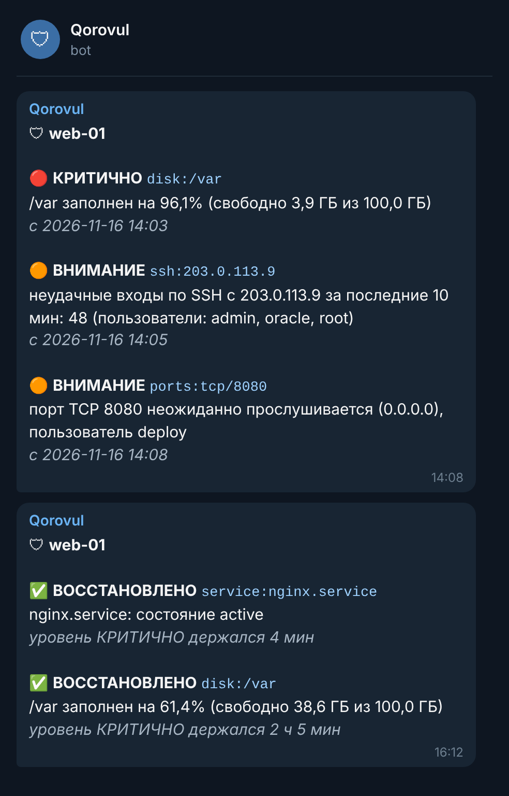

# Qorovul

[English](README.md) · [Oʻzbekcha](README.uz.md) · **Русский** · [Türkçe](README.tr.md) · [한국어](README.ko.md)

**Qorovul** (по-узбекски «сторож») — лёгкий сторож для Linux-серверов. Работает
как служба systemd на том же сервере, который наблюдает, и отправляет
оповещения в Telegram.

Без веб-интерфейса, без базы данных, без открытых входящих портов и без
центрального сервера. Один процесс Python, около 33 МБ памяти и меньше 1 %
одного ядра процессора.

Qorovul следит за шестью вещами:

| Проверка  | Когда оповещает | Ключ |
|-----------|-----------------|------|
| `disk`    | файловая система заполнена на ≥ 85 % (критично при ≥ 95 %) | `disk:/var` |
| `memory`  | ОЗУ занята на ≥ 90 % три проверки подряд (критично при ≥ 97 %) | `memory:ram` |
| `service` | указанная служба systemd не в состоянии `active` | `service:nginx.service` |
| `ssh`     | один IP набрал 20 неудачных входов за 10 минут | `ssh:203.0.113.9` |
| `ssl`     | сертификат домена истекает в течение 14 дней (критично — 3 дня) | `ssl:example.com` |
| `ports`   | слушает TCP-порт, которого нет в списке разрешённых | `ports:tcp/8080` |

Каждое оповещение отправляется **один раз**. Напоминание приходит, только если
проблема сохраняется дольше cooldown (по умолчанию 6 ч), а когда она уходит —
сообщение **ВОССТАНОВЛЕНО**.



---

## Установка за 60 секунд

1. **Создайте бота.** Напишите [@BotFather](https://t.me/BotFather) команду
   `/newbot` и скопируйте токен (`123456789:AAE...`).
2. **Узнайте chat id.** Отправьте боту любое сообщение, откройте
   `https://api.telegram.org/bot<TOKEN>/getUpdates` и возьмите `"chat":{"id": ...}`.
   Для группы сначала добавьте в неё бота; id групп отрицательные.
3. **Установите** на сервер (Ubuntu 22.04+, Debian 12+, AlmaLinux/RHEL 9 с systemd):

   ```bash
   curl -fsSL https://raw.githubusercontent.com/Qoshmurod/Security-/main/install.sh | sudo bash
   ```

   Установщик спросит язык, токен и chat id, запустит службу и отправит
   тестовое сообщение. Без вопросов:

   ```bash
   curl -fsSL https://raw.githubusercontent.com/Qoshmurod/Security-/main/install.sh \
     | sudo QOROVUL_LANGUAGE=ru QOROVUL_BOT_TOKEN='123456789:AAE...' QOROVUL_CHAT_ID='123456789' bash
   ```

4. **Расскажите ему о сервере** в `/etc/qorovul/config.yml`: какие службы
   отслеживать, ваши домены и порты, которые должны быть открыты:

   ```yaml
   checks:
     service: { units: [nginx, postgresql] }
     ssl:     { domains: [example.com] }
     ports:   { allowed: [22, 80, 443] }
   ```

   Затем: `sudo systemctl restart qorovul && sudo -u qorovul qorovul test`.

Готово. Текущее состояние покажет `qorovul status`.

---

## Язык

Сообщения в Telegram, результаты проверок, `qorovul test` и `qorovul status`
доступны на 14 языках:

`en` English · `uz` Oʻzbekcha · `ru` Русский · `tr` Türkçe · `ko` 한국어 ·
`zh` 简体中文 · `ja` 日本語 · `es` Español · `pt` Português · `fr` Français ·
`de` Deutsch · `ar` العربية · `hi` हिन्दी · `id` Bahasa Indonesia

```yaml
language: ru        # или auto: по локали сервера ($LANG)
```

Для одной команды: `qorovul status --lang ru`. Для службы язык можно
переопределить переменной `QOROVUL_LANG`.

Числа оформляются по правилам языка: `87,3%`, `13,7 ГБ`, `2 ч 5 мин`.
Журнал и ошибки конфигурации намеренно остаются на английском — их ищут и
вставляют в отчёты об ошибках.

---

## Как работают оповещения

У каждого результата есть постоянный **ключ**, а его состояние хранится в
`/var/lib/qorovul/state.json`. Поэтому перезапуск, обновление или сбой не
повторяют уже полученные оповещения.

| Ситуация | Что вы получите |
|----------|-----------------|
| Проблема появилась | одно **оповещение** |
| Проблема сохраняется | ничего, ни на одной проверке |
| …сохраняется дольше `cooldown` (6 ч) | одно напоминание **ВСЁ ЕЩЁ**, затем раз в 6 ч |
| Уровень вырос (внимание → критично) | сразу, без ожидания cooldown |
| Две проверки подряд в норме | одно **ВОССТАНОВЛЕНО** |
| Восстановилось до того, как вас оповестили | ничего |
| Короткий сбой (например, служба перезапускается) | ничего |
| Тихие часы, не критично | ждёт и отправляется после тихих часов |
| Тихие часы, критично | сразу |
| Telegram недоступен | повторяет до доставки (30 с, 1 мин, 2 мин … каждые 5 мин) |

### Если сервер упал целиком

Qorovul работает на самом наблюдаемом сервере и не может сообщить о его
падении. Для этого укажите в `heartbeat.url` адрес пинга любого сервиса
«dead man's switch» (healthchecks.io, push-монитор Uptime Kuma и т. п.).
Qorovul обращается к нему каждые 5 минут; когда пинги прекращаются, оповещает
*этот* сервис.

Если завис сам процесс Qorovul, это заметит systemd (`WatchdogSec=10min`):
он завершит процесс и запустит заново.

---

## Права

Qorovul работает от непривилегированного пользователя **`qorovul`**: без
capabilities, с `NoNewPrivileges` и файловой системой только для чтения.
Писать можно только в `/var/lib/qorovul`.

Для диска, памяти, служб, портов и сертификатов **дополнительные права не
нужны**: порты читаются из `/proc/net/tcp`, без `ss` и root. Чтение журналов
SSH выдаётся через стандартные группы: `adm` для `/var/log/auth.log` в
Debian/Ubuntu и `systemd-journal` для journald.

Имя процесса в оповещениях о портах — по желанию и выключено по умолчанию:
нужные для этого права позволяют читать любой файл. Как включить — в
[английском README](README.md#optional-process-names-in-port-alerts).

---

## Команды

```
qorovul run [--once]     основной цикл (его запускает systemd)
qorovul test             выполнить все проверки один раз и отправить тестовое сообщение
qorovul status [--json]  текущее состояние и последнее оповещение по каждому ключу
qorovul version
```

Все команды принимают `-c ФАЙЛ` и `--lang ЯЗЫК`.

### Удаление

```bash
sudo systemctl disable --now qorovul
sudo rm -rf /etc/systemd/system/qorovul.service /etc/systemd/system/qorovul.service.d \
            /opt/qorovul /usr/local/bin/qorovul /var/lib/qorovul /etc/qorovul
sudo userdel qorovul
sudo systemctl daemon-reload
```

---

Полное описание каждой настройки, тестов и установки — в
[английском README](README.md). Каждая настройка прокомментирована в
[`config.example.yml`](config.example.yml).

Лицензия: [MIT](LICENSE)
