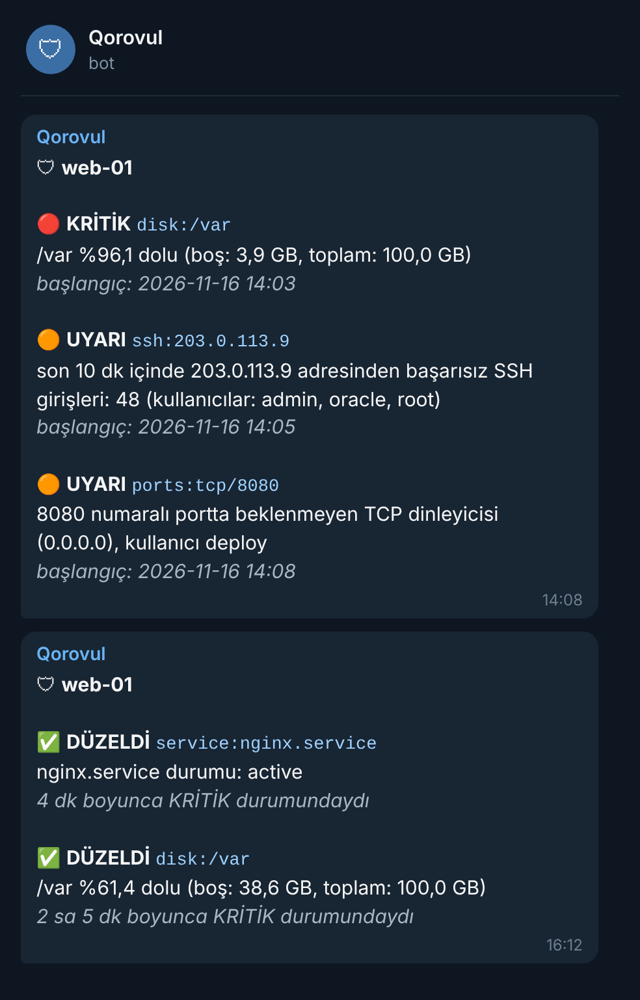

# Qorovul

[English](README.md) · [Oʻzbekcha](README.uz.md) · [Русский](README.ru.md) · **Türkçe** · [한국어](README.ko.md)

**Qorovul** (Özbekçe "bekçi"), Linux sunucular için hafif bir gözcüdür.
İzlediği sunucunun kendisinde systemd servisi olarak çalışır ve uyarıları
Telegram'a gönderir.

Web arayüzü, veritabanı, açık gelen port ya da merkezi sunucu yoktur. Tek bir
Python süreci, yaklaşık 33 MB bellek ve bir işlemci çekirdeğinin %1'inden azı.

Qorovul altı şeyi izler:

| Denetim   | Ne zaman uyarır | Anahtar |
|-----------|-----------------|---------|
| `disk`    | bir dosya sistemi ≥ %85 dolduğunda (≥ %95'te kritik) | `disk:/var` |
| `memory`  | RAM art arda 3 denetimde ≥ %90 dolu olduğunda (≥ %97'de kritik) | `memory:ram` |
| `service` | listedeki bir systemd birimi `active` olmadığında | `service:nginx.service` |
| `ssh`     | tek bir IP 10 dakikada 20 başarısız girişe ulaştığında | `ssh:203.0.113.9` |
| `ssl`     | alan adı sertifikası 14 gün içinde dolacaksa (3 gün içinde kritik) | `ssl:example.com` |
| `ports`   | izin listesinde olmayan bir TCP portu dinlemeye başladığında | `ports:tcp/8080` |

Her uyarı **bir kez** gönderilir. Sorun cooldown süresinden (varsayılan 6 sa)
sonra da sürüyorsa hatırlatma gelir; sorun giderildiğinde **DÜZELDİ** mesajı gelir.



---

## 60 saniyede kurulum

1. **Bir bot oluşturun.** Telegram'da [@BotFather](https://t.me/BotFather)'a
   `/newbot` gönderin ve token'ı (`123456789:AAE...`) kopyalayın.
2. **Chat id'yi alın.** Yeni botunuza herhangi bir mesaj yazın, ardından
   `https://api.telegram.org/bot<TOKEN>/getUpdates` adresini açıp
   `"chat":{"id": ...}` değerini alın. Grup için önce botu gruba ekleyin;
   grup id'leri negatiftir.
3. **Sunucuya kurun** (systemd'li Ubuntu 22.04, 24.04 veya 26.04, Debian 12+, AlmaLinux/RHEL 9):

   ```bash
   curl -fsSL https://raw.githubusercontent.com/Qoshmurod/Security-/main/install.sh | sudo bash
   ```

   Kurulum dili, token'ı ve chat id'yi sorar, servisi başlatır ve bir test
   mesajı gönderir. Soru sormadan kurmak için:

   ```bash
   curl -fsSL https://raw.githubusercontent.com/Qoshmurod/Security-/main/install.sh \
     | sudo QOROVUL_LANGUAGE=tr QOROVUL_BOT_TOKEN='123456789:AAE...' QOROVUL_CHAT_ID='123456789' bash
   ```

4. `/etc/qorovul/config.yml` dosyasında **sunucunuzu tanıtın**: izlenecek
   servisler, alan adlarınız ve açık olması gereken portlar:

   ```yaml
   checks:
     service: { units: [nginx, postgresql] }
     ssl:     { domains: [example.com] }
     ports:   { allowed: [22, 80, 443] }
   ```

   Ardından: `sudo systemctl restart qorovul && sudo -u qorovul qorovul test`.

Bu kadar. Güncel durumu `qorovul status` gösterir.

---

## Dil

Telegram mesajları, denetim sonuçları, `qorovul test` ve `qorovul status`
14 dilde kullanılabilir:

`en` English · `uz` Oʻzbekcha · `ru` Русский · `tr` Türkçe · `ko` 한국어 ·
`zh` 简体中文 · `ja` 日本語 · `es` Español · `pt` Português · `fr` Français ·
`de` Deutsch · `ar` العربية · `hi` हिन्दी · `id` Bahasa Indonesia

```yaml
language: tr        # ya da auto: sunucunun yerel ayarından ($LANG)
```

Tek bir komut için: `qorovul status --lang tr`. Servis için `QOROVUL_LANG`
ortam değişkeni ayarı geçersiz kılar.

Sayılar her dilin kurallarına göre yazılır: Türkçede `%87,3`, `13,7 GB`,
`2 sa 5 dk`. Günlük (log) ve yapılandırma hataları bilerek İngilizce kalır;
bunlar aranır ve hata raporlarına yapıştırılır.

---

## Uyarılar nasıl çalışır

Her sonucun sabit bir **anahtarı** vardır ve her anahtarın durumu
`/var/lib/qorovul/state.json` dosyasında tutulur. Bu yüzden yeniden başlatma,
güncelleme ya da çökme, zaten aldığınız uyarıları tekrarlamaz.

| Durum | Ne alırsınız |
|-------|--------------|
| Sorun başladı | bir **uyarı** |
| Sorun sürüyor | hiçbir şey, hiçbir denetimde |
| …`cooldown` (6 sa) sonrasında da sürüyor | bir **HÂLÂ** hatırlatması, sonra 6 saatte bir |
| Seviye yükseldi (uyarı → kritik) | hemen, cooldown beklenmez |
| Art arda 2 denetimde normal | bir **DÜZELDİ** |
| Size bildirilmeden düzeldi | hiçbir şey |
| Kısa kesinti (ör. servis yeniden başlıyor) | hiçbir şey |
| Sessiz saatler, kritik değil | bekletilir, sessiz saatler bitince gönderilir |
| Sessiz saatler, kritik | hemen |
| Telegram'a ulaşılamıyor | iletilene kadar yeniden dener (30 sn, 1 dk, 2 dk … 5 dakikada bir) |

### Sunucu tamamen çökerse

Qorovul izlediği sunucunun kendisinde çalışır; sunucu çökerse bunu kendisi
bildiremez. Bunun için `heartbeat.url` alanına herhangi bir "dead man's switch"
servisinin ping adresini yazın (healthchecks.io, Uptime Kuma "push" monitörü
vb.). Qorovul ona 5 dakikada bir istek gönderir; pingler durduğunda *o servis*
sizi uyarır.

Qorovul süreci donarsa bunu systemd fark eder (`WatchdogSec=10min`): süreci
sonlandırır ve yeniden başlatır.

---

## İzinler

Qorovul ayrıcalıksız **`qorovul`** kullanıcısı olarak çalışır: hiçbir
capability yok, `NoNewPrivileges` açık ve dosya sistemi salt okunur. Yazılabilen
tek yer `/var/lib/qorovul`'dur.

Disk, bellek, servisler, portlar ve sertifikalar için **ek izin gerekmez**:
portlar `/proc/net/tcp`'den okunur, `ss` ya da root kullanılmaz. SSH
günlüklerini okuma izni standart gruplarla verilir: Debian/Ubuntu'da
`/var/log/auth.log` için `adm`, journald için `systemd-journal`.

Port uyarılarında süreç adı isteğe bağlıdır ve varsayılan olarak kapalıdır:
bunun için gereken izinler herhangi bir dosyayı okumaya da olanak tanır.
Nasıl açılacağı [İngilizce README](README.md#optional-process-names-in-port-alerts)'de
yazıyor.

---

## Komutlar

```
qorovul run [--once]     ana döngü (systemd bunu çalıştırır)
qorovul test             tüm denetimleri bir kez çalıştırır ve test mesajı gönderir
qorovul status [--json]  güncel durum ve her anahtar için son uyarı
qorovul version
```

Tüm komutlar `-c DOSYA` ve `--lang DİL` kabul eder.

### Kaldırma

```bash
sudo systemctl disable --now qorovul
sudo rm -rf /etc/systemd/system/qorovul.service /etc/systemd/system/qorovul.service.d \
            /opt/qorovul /usr/local/bin/qorovul /var/lib/qorovul /etc/qorovul
sudo userdel qorovul
sudo systemctl daemon-reload
```

---

Her ayarın tam açıklaması, testler ve kurulum ayrıntıları
[İngilizce README](README.md)'de. Her ayar
[`config.example.yml`](config.example.yml) dosyasında açıklanmıştır.

Lisans: [MIT](LICENSE)
