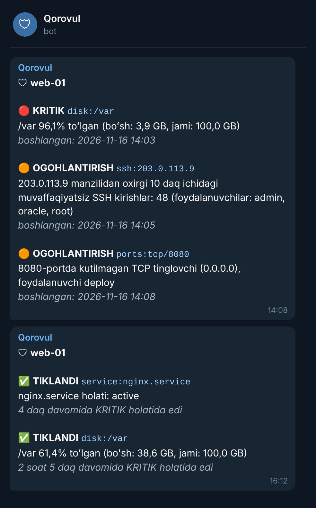

# Qorovul

[English](README.md) · **Oʻzbekcha** · [Русский](README.ru.md) · [Türkçe](README.tr.md) · [한국어](README.ko.md)

**Qorovul** — Linux serverlar uchun yengil kuzatuvchi. U kuzatayotgan serverning
oʻzida systemd xizmati sifatida ishlaydi va ogohlantirishlarni Telegramga yuboradi.

Veb-interfeys, maʼlumotlar bazasi, ochiq kiruvchi port yoki markaziy server yoʻq.
Bitta Python jarayoni, taxminan 33 MB xotira va protsessorning 1% dan kami.

Qorovul oltita narsani kuzatadi:

| Tekshiruv | Qachon ogohlantiradi | Kalit |
|-----------|----------------------|-------|
| `disk`    | fayl tizimi ≥ 85% toʻlganda (≥ 95% da kritik) | `disk:/var` |
| `memory`  | operativ xotira ketma-ket 3 tekshiruvda ≥ 90% band boʻlsa (≥ 97% da kritik) | `memory:ram` |
| `service` | roʻyxatdagi systemd xizmati `active` holatida boʻlmasa | `service:nginx.service` |
| `ssh`     | bitta IP 10 daqiqada 20 marta muvaffaqiyatsiz kirishga urinsa | `ssh:203.0.113.9` |
| `ssl`     | domen sertifikatining muddati 14 kun ichida tugasa (3 kun ichida — kritik) | `ssl:example.com` |
| `ports`   | ruxsat roʻyxatida yoʻq TCP port tinglay boshlasa | `ports:tcp/8080` |

Har bir ogohlantirish **bir marta** yuboriladi. Muammo cooldown vaqtidan keyin
(sukut boʻyicha 6 soat) ham saqlanib qolsa, eslatma keladi. Muammo bartaraf
boʻlganda esa **TIKLANDI** xabari keladi.



---

## 60 soniyada oʻrnatish

1. **Bot yarating.** Telegramda [@BotFather](https://t.me/BotFather) ga `/newbot`
   yuboring va tokenni (`123456789:AAE...`) nusxalab oling.
2. **Chat ID ni oling.** Yangi botingizga istalgan xabar yozing, soʻng
   `https://api.telegram.org/bot<TOKEN>/getUpdates` manzilini oching va
   `"chat":{"id": ...}` qiymatini oling. Guruh uchun avval botni guruhga
   qoʻshing; guruh ID lari manfiy boʻladi.
3. **Serverga oʻrnating** (systemd boʻlgan Ubuntu 22.04, 24.04 yoki 26.04, Debian 12+, AlmaLinux/RHEL 9):

   ```bash
   curl -fsSL https://raw.githubusercontent.com/Qoshmurod/Security-/main/install.sh | sudo bash
   ```

   Oʻrnatuvchi tilni, tokenni va chat ID ni soʻraydi, xizmatni ishga tushiradi
   va sinov xabarini yuboradi. Savollarsiz oʻrnatish uchun:

   ```bash
   curl -fsSL https://raw.githubusercontent.com/Qoshmurod/Security-/main/install.sh \
     | sudo QOROVUL_LANGUAGE=uz QOROVUL_BOT_TOKEN='123456789:AAE...' QOROVUL_CHAT_ID='123456789' bash
   ```

4. `/etc/qorovul/config.yml` faylida **serveringiz haqida maʼlumot bering**:
   kuzatiladigan xizmatlar, domenlar va ochiq boʻlishi kerak boʻlgan portlar:

   ```yaml
   checks:
     service: { units: [nginx, postgresql] }
     ssl:     { domains: [example.com] }
     ports:   { allowed: [22, 80, 443] }
   ```

   Soʻng: `sudo systemctl restart qorovul && sudo -u qorovul qorovul test`.

Tamom. Joriy holatni `qorovul status` koʻrsatadi.

---

## Til

Telegram xabarlari, tekshiruv natijalari, `qorovul test` va `qorovul status`
14 tilda ishlaydi:

`en` English · `uz` Oʻzbekcha · `ru` Русский · `tr` Türkçe · `ko` 한국어 ·
`zh` 简体中文 · `ja` 日本語 · `es` Español · `pt` Português · `fr` Français ·
`de` Deutsch · `ar` العربية · `hi` हिन्दी · `id` Bahasa Indonesia

```yaml
language: uz        # yoki auto: server tilidan ($LANG) olinadi
```

Bitta buyruq uchun: `qorovul status --lang ru`. Xizmat uchun sozlamani
`QOROVUL_LANG` muhit oʻzgaruvchisi bilan ham almashtirish mumkin.

Sonlar har bir tilning qoidasi bilan yoziladi: oʻzbekchada `87,3%`, `13,7 GB`,
`2 soat 5 daq`. Jurnal (log) va sozlama xatolari ataylab inglizcha qoladi,
chunki ular qidiruv va xatolik hisobotlari uchun kerak.

---

## Ogohlantirishlar qanday ishlaydi

Har bir natijaning oʻzgarmas **kaliti** bor. Har bir kalitning holati
`/var/lib/qorovul/state.json` faylida saqlanadi. Shuning uchun qayta ishga
tushirish, yangilash yoki toʻsatdan toʻxtash allaqachon olgan ogohlantirishingizni
qayta yubormaydi.

| Vaziyat | Siz nima olasiz |
|---------|-----------------|
| Muammo paydo boʻldi | bitta **ogohlantirish** |
| Muammo davom etmoqda | hech narsa, har tekshiruvda ham |
| `cooldown` (6 soat) dan keyin ham davom etmoqda | bitta **HAMON** eslatmasi, soʻng har 6 soatda |
| Daraja oshdi (ogohlantirish → kritik) | darhol, cooldown kutilmaydi |
| Ketma-ket 2 tekshiruvda joyida | bitta **TIKLANDI** |
| Sizga xabar berilmasdan tiklandi | hech narsa |
| Qisqa uzilish (masalan, xizmat qayta ishga tushayotgan payt) | hech narsa |
| Sokin soatlar, kritik emas | kutib turadi va sokin soatlar tugagach yuboriladi |
| Sokin soatlar, kritik | darhol |
| Telegram ishlamayapti | yetkazilguncha qayta urinadi (30 s, 1 daq, 2 daq … har 5 daq) |

### Server butunlay oʻchsa

Qorovul kuzatayotgan serverning oʻzida ishlaydi, shuning uchun server oʻchib
qolsa, buni oʻzi xabar qila olmaydi. Buning uchun `heartbeat.url` ga istalgan
"dead man's switch" xizmatining ping manzilini kiriting (healthchecks.io,
Uptime Kuma "push" monitori va hokazo). Qorovul unga har 5 daqiqada murojaat
qiladi. Pinglar toʻxtasa, *oʻsha xizmat* sizga xabar beradi.

Qorovul jarayonining oʻzi qotib qolsa, buni systemd payqaydi
(`WatchdogSec=10min`): jarayonni toʻxtatib, qayta ishga tushiradi.

---

## Ruxsatlar

Qorovul imtiyozsiz **`qorovul`** foydalanuvchisi nomidan ishlaydi:
hech qanday capability yoʻq, `NoNewPrivileges` yoqilgan, fayl tizimini faqat
oʻqiy oladi. Yozish mumkin boʻlgan yagona joy — `/var/lib/qorovul`.

Disk, xotira, xizmatlar, portlar va sertifikatlar uchun **hech qanday qoʻshimcha
ruxsat kerak emas**. Portlar `/proc/net/tcp` dan oʻqiladi, `ss` ham, root ham
ishlatilmaydi. Faqat SSH loglari uchun standart guruhlar orqali oʻqish
ruxsati beriladi:
- Debian/Ubuntu'da `/var/log/auth.log` uchun `adm` guruhi;
- journald uchun `systemd-journal` guruhi.

Port ogohlantirishlarida jarayon nomini koʻrsatish ixtiyoriy va sukut boʻyicha
oʻchiq: uning uchun kerak boʻlgan ruxsatlar har qanday faylni oʻqishga ham
imkon beradi. Qanday yoqish [inglizcha README](README.md#optional-process-names-in-port-alerts)
da yozilgan.

---

## Buyruqlar

```
qorovul run [--once]     asosiy sikl (systemd shuni ishga tushiradi)
qorovul test             barcha tekshiruvlarni bir marta bajaradi va sinov xabarini yuboradi
qorovul status [--json]  joriy holat va har bir kalit boʻyicha oxirgi xabar
qorovul version
```

Har bir buyruq `-c FAYL` va `--lang TIL` parametrlarini qabul qiladi.

### Oʻchirish

```bash
sudo systemctl disable --now qorovul
sudo rm -rf /etc/systemd/system/qorovul.service /etc/systemd/system/qorovul.service.d \
            /opt/qorovul /usr/local/bin/qorovul /var/lib/qorovul /etc/qorovul
sudo userdel qorovul
sudo systemctl daemon-reload
```

---

Har bir sozlamaning toʻliq tavsifi, sinovlar va oʻrnatish tafsilotlari
[inglizcha README](README.md) da. Har bir sozlama
[`config.example.yml`](config.example.yml) faylida izohlangan.

Litsenziya: [MIT](LICENSE)
